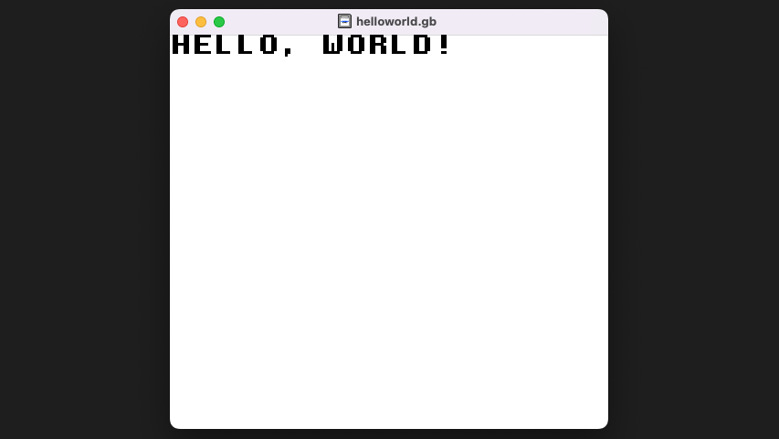

GBDK is open source, with release builds available on GitHub. I was using macOS when I wrote this tutorial, so I will start with setting up GBDK on macOS and compiling a Hello World program. The general process is similar on Linux and Windows, although the installation details differ. Feel free to leave a comment if you run into trouble.

<!--more-->


This tutorial describes my December 2022 setup. The release links and versions below are retained from that setup; use the upstream release pages when choosing a version for a new installation.


## Download GBDK

At the time of writing, the stable version was v4.1.1. [Download the macOS archive](https://github.com/gbdk-2020/gbdk-2020/releases/download/4.1.1/gbdk-macos.tar.gz), or find other versions on the [releases page](https://github.com/gbdk-2020/gbdk-2020/releases).

## Directory structure

Extract the archive to get a directory named `gbdk`. Its contents include:

-  `bin/`: prebuilt executable tools
-  `include/`: header files
-  `lib/`: libraries
-  `examples/`: example programs
-  `licenses/`: licences
-  `gbdk_manual.pdf`: the GBDK manual
-  `sdccman.pdf`: the SDCC manual
-  `ChangeLog`: release changes
-  `README`: introductory information

Next, move this directory to a suitable location and configure the environment.

## Install GBDK and set environment variables

For example, copy the directory to `/opt/gbdk`:

```bash
sudo cp -r gbdk /opt/gbdk
```

Then set the environment variable.


To make it persistent, add the setting to `/etc/profile` or your shell's configuration file. Choose the appropriate file; you do not need to update all three.






```bash
echo "export GBDKDIR=/opt/gbdk/" | sudo tee -a /etc/profile
```




```bash
echo "export GBDKDIR=/opt/gbdk/" | tee -a ~/.bashrc
```




```bash
echo "export GBDKDIR=/opt/gbdk/" | tee -a ~/.zshrc
```





The commands in this tutorial use `GBDKDIR`. You can also add its `bin` directory to `PATH` to invoke the tools without their full paths.


## Prepare the GBDK versions of GBTD and GBMB

GBTD (Game Boy Tile Designer) and GBMB (Game Boy Map Builder) are used for tile graphics and tile maps. GBTD draws the tiles; GBMB arranges those tiles into a map.

We will use both tools later. [Download the 2.4.5 archive](https://github.com/gbdk-2020/GBTD_GBMB/releases/download/2.4.5/GBTD_GBMB_release.zip), or choose a version from the [releases page](https://github.com/gbdk-2020/GBTD_GBMB/releases).

Extract it to get a `GBTD_GBMB_release` directory containing `GBTD` and `GBMB`. Create a `tools` directory inside `gbdk`, then copy the tool directories into it. On macOS or Linux:

```bash
sudo mkdir -p "$GBDKDIR/tools"
cd GBTD_GBMB_release
sudo cp -r GBTD "$GBDKDIR/tools/"
sudo cp -r GBMB "$GBDKDIR/tools/"
```


If the tools cannot save their `.ini` settings, check the files' ownership and give your account write access to those files. The original setup used a blanket `chmod 777`; that is unnecessary. A user-owned copy of the tools is another option when a system-wide installation is not needed.



On macOS and Linux, these tools need a compatible Wine installation. Wine runs Windows applications by providing compatible implementations of Windows APIs.






If you do not have Homebrew installed, follow the instructions on the [Homebrew website](https://brew.sh/).

My 2022 setup used the Wine-CrossOver packages from `gcenx/wine`:

```bash
brew install --formula gcenx/wine/winetricks
brew install --cask --no-quarantine gcenx/wine/wine-crossover
```

These are historical package names and commands, rather than instructions tested on current macOS. Consult the [upstream project](https://github.com/Gcenx/homebrew-wine) for your current system.




The original tutorial did not include distribution-specific Wine installation instructions. Install Wine for your distribution, then launch the tools as shown below.




### Launch GBTD and GBMB with Wine

Once Wine is configured, run:

```bash
wine "$GBDKDIR/tools/GBTD/gbtd.exe"
wine "$GBDKDIR/tools/GBMB/gbmb.exe"
```

For convenience, add aliases to your shell configuration. For example, in `~/.zshrc`:

```bash
alias gbtd='wine "$GBDKDIR/tools/GBTD/gbtd.exe"'
alias gbmb='wine "$GBDKDIR/tools/GBMB/gbmb.exe"'
```

Use `~/.bashrc` for Bash, or the appropriate configuration file for your shell. Open a new shell after editing it.

## Prepare an emulator: SameBoy

I chose [SameBoy](https://github.com/LIJI32/SameBoy), an open-source, cross-platform emulator with debugging features that are useful during development.

Choose a build for your platform from the [download page](https://sameboy.github.io/downloads/). For this tutorial, I used [SameBoy v0.15.8 for macOS](https://github.com/LIJI32/SameBoy/releases/download/v0.15.8/sameboy_cocoa_v0.15.8.zip). Extract the app and drag it into `Applications`.

## Hello, world!

Let's write our first program: display a line of text on the Game Boy screen.

### Write the source

Create `helloworld.c`:

```c
#include <gb/gb.h>
#include <stdio.h>

void main()
{
    printf("HELLO, WORLD!");
}
```

### Compile from the command line

Open a terminal in the directory containing `helloworld.c` and run:

```bash
$GBDKDIR/bin/lcc -Wa-l -Wl-m -Wl-j -o helloworld.gb helloworld.c
```

This produces `helloworld.gb`, a ROM file that can be opened in an emulator.

### Open the ROM in SameBoy




You can also add an alias for SameBoy to your shell configuration:

```bash
alias sameboy=/Applications/SameBoy.app/Contents/MacOS/SameBoy
```

Then open the ROM directly from the terminal:

```bash
sameboy helloworld.gb
```


Congratulations — you have built and run your first Game Boy program! 🎉
