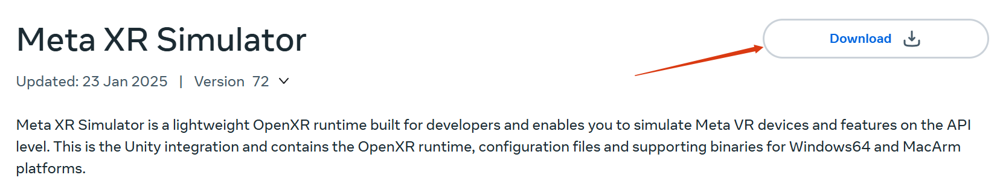

如果你没有 XR 头显，但你想开发 OpenXR 应用，你可以使用 Meta XR 仿真器，它还不错。

<!--more-->

## 下载 Meta XR Simulator




从 [这里](https://developers.meta.com/horizon/downloads/package/meta-xr-simulator) 下载。

你将会得到一个压缩文件，你需要解压它，并获取必要文件。

我们只需要 `MetaXRSimulator` 文件夹。将它拷贝到你的本地机器的某处，例如 `C:\MetaXRSimulator`。

## 配置默认 OpenXR 运行时 & 运行

在 Windows 上，有两个选项可供配置当前活跃的 OpenXR 运行时：
- Windows 注册表项
- 环境变量

我建议你在 IDE 或者终端里使用一个临时的环境变量 (`XR_RUNTIME_JSON`) 去设置当前活跃的 OpenXR 运行时，这将不会替换系统默认的 OpenXR 运行时。





```powershell
$Env:XR_RUNTIME_JSON = "C:\MetaXRSimulator\meta_openxr_simulator.json"
# 然后运行你的 OpenXR 应用
```




```batch
set XR_RUNTIME_JSON="C:\MetaXRSimulator\meta_openxr_simulator.json"
# 然后运行你的 OpenXR 应用
```




设置好环境变量后，在同终端内启动你的 OpenXR 应用即可！

玩得开心！